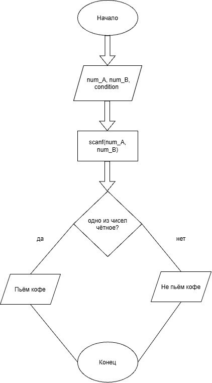

# Домашнее задание к работе 4

## Уловие задачи
Два программиста, Анна (A) и Борис (B), дежурят ночью. Чтобы было не так скучно, они решили, что будут пить кофе только если кто-то один из них четный (по номеру своего рабочего места). Запишите условие для кофе-машины.

### Блок-схема

## 3. Результаты работы программы

[Расчет:
Введите два целых числа (номера мест Анны и Бориса): 11
2
Пьём кофе? (1 - да, 0 - нет): 1

## 4. Информация о разработчике

Азиханов Дамир, бТИИ-262
